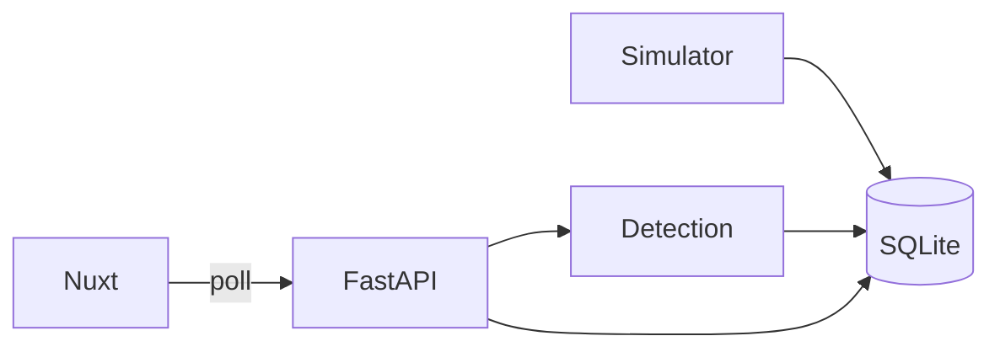

# 管線洩漏監測系統（LDS）實作計畫

> **For agentic workers:** 實作時依 task 逐步完成；規格先寫入 `docs/` 再寫程式。

**Goal:** 建立可本機運行的單管線洩漏監測 MVP：模擬感測資料、三種偵測模式、即時儀表板與歷史查詢。

**Architecture:** FastAPI 背景模擬器持續寫入 SQLite；REST API 提供讀數、狀態與偵測結果；Nuxt 前端輪詢即時頁並以時間區間查歷史。CORS 全開；無登入。

**Tech Stack:** Nuxt 3、Ant Design Vue、Plotly.js、FastAPI、SQLAlchemy、SQLite、pytest、uv（Python 套件與虛擬環境）

## Global Constraints

- 目錄：`frontend/`、`backend/`、`docs/`、`data/`（DB 檔，gitignore）
- **後端 Python：在 `backend/` 用 [uv](https://github.com/astral-sh/uv) 建立虛擬環境（`.venv`），所有 Python 套件只裝進該環境；以 `pyproject.toml` + `uv.lock` 鎖定依賴**
- CORS：`allow_origins=["*"]`
- 單管線、模擬資料、無認證
- 狀態兩軸：輸送 `輸送中|停輸`；監測 `正常|觀察|告警`
- 演算法：壓力梯度、流量變化量、壓力波（簡化可擴充）

## 目標目錄結構

```
LDS/
  .gitignore
  README.md
  data/                 # gitignored; lds.db
  docs/
    superpowers/specs/2026-10-30-lds-design.md
    superpowers/plans/2026-10-30-lds-mvp.md
  backend/
    .venv/              # uv 虛擬環境（gitignore）
    pyproject.toml
    uv.lock
    app/main.py
    app/config.py
    app/db.py
    app/models.py
    app/schemas.py
    app/api/...
    app/services/simulator.py
    app/services/detection/{gradient,flow_imbalance,pressure_wave,aggregate}.py
    tests/...
  frontend/
    nuxt.config.ts
    pages/index.vue      # 即時監測
    pages/history.vue    # 歷史查詢
    components/...
    composables/useApi.ts
```

## 資料模型（SQLite）

- `pipeline`：length_m, diameter_m, content_type, name
- `sensor_reading`：ts, pressure_in/out, flow_in/out, temperature
- `detection_result`：ts, method, leak_suspected, severity, metrics_json
- `sim_state`：leak_injected bool, transport_running bool（或等價設定）

## API

- `GET /api/health`
- `GET /api/pipeline`
- `GET /api/readings/latest?limit=`
- `GET /api/readings?from=&to=`
- `GET /api/status` — transport_status, monitor_status, content, latest readings, rates, per-method results
- `GET /api/detections?from=&to=`
- `POST /api/sim/leak` — body `{ enabled: bool }`
- `POST /api/sim/transport` — body `{ running: bool }`（控制輸送中／停輸）

## 前端畫面

- **即時監測**：狀態摘要（輸送／監測兩軸 + 內容物 + 最新 P/Q/T）、流量與壓力 Plotly 趨勢、變化率、三演算法結果、模擬控制
- **歷史查詢**：區間選擇 → 趨勢圖 + 偵測表
- 輪詢約 2–3 秒；API 失敗用 AntDV message，保留上次圖資料



---

### Task 1: 規格文件與 repo 骨架

- 寫入設計規格 [`docs/superpowers/specs/2026-10-30-lds-design.md`](docs/superpowers/specs/2026-10-30-lds-design.md)（含上述決策；請使用者快速過目）
- 寫入本計畫副本至 [`docs/superpowers/plans/2026-10-30-lds-mvp.md`](docs/superpowers/plans/2026-10-30-lds-mvp.md)
- 更新根 [`README.md`](README.md)、[`.gitignore`](.gitignore)（`data/`、`*.db`、`node_modules`、`.nuxt`、`__pycache__`、`backend/.venv/` 等）
- 建立空目錄 `backend/`、`frontend/`、`data/.gitkeep` 策略：忽略 db 但可保留目錄說明於 README

### Task 2: uv 虛擬環境 + FastAPI 專案 + DB 模型

- 在 `backend/` 執行 `uv init`／`uv venv`，以 `uv add` 安裝依賴（fastapi、uvicorn、sqlalchemy、pydantic、pytest 等），產生 `pyproject.toml` + `uv.lock`；套件僅安裝於 `backend/.venv`
- 後續指令一律用 `uv run ...`（例如 `uv run uvicorn`、`uv run pytest`），避免系統 Python
- `app/db.py`、`models.py`、種子一筆 pipeline
- `GET /api/health`、`GET /api/pipeline` 可跑
- 單元／冒煙測試通過（`uv run pytest`）

### Task 3: 模擬器 + readings API

- 背景 task：每 N 秒寫 `sensor_reading`（噪音；停輸時流量近 0；洩漏注入時進出口失衡／壓力偏移）
- `GET /api/readings/latest`、`GET /api/readings`
- `POST /api/sim/leak`、`POST /api/sim/transport`
- 測試：注入洩漏後讀數出現可預期偏移

### Task 4: 三種偵測演算法 + status/detections API

- `pressure_gradient`、`flow_imbalance`、`pressure_wave` 模組 + 彙總 `正常|觀察|告警`
- 每次模擬 tick 後寫入 `detection_result`
- `GET /api/status`、`GET /api/detections`
- 測試：正常 vs 洩漏情境狀態差異

### Task 5: Nuxt 前端骨架 + API 連線

- `nuxi` 初始化、安裝 `ant-design-vue`、`plotly.js`（及 vue 包裝若需要）
- `nuxt.config` proxy 或 `runtimeConfig.public.apiBase`
- 佈局與導航：即時／歷史

### Task 6: 即時監測頁

- 狀態摘要、Plotly 流量／壓力圖、變化率、三方法結果、模擬開關
- composable 輪詢 `/api/status` + `/api/readings/latest`

### Task 7: 歷史查詢頁 + README 啟動說明

- 日期時間區間 → readings／detections 圖表與表格
- README：後端先 `cd backend && uv sync`，再 `uv run uvicorn app.main:app --reload`；前端 `npm run dev`；預設埠、如何示範洩漏

### Task 8: 端到端煙霧驗證

- 同時啟動前後端，確認即時刷新、注入洩漏出現告警、歷史區間有資料
- 必要時補小修

## 實作時注意

- 演算法第一版以可解釋閾值為主，介面預留擴充；不追求工業級物理精度
- 不提交 `data/*.db`、不提交 `backend/.venv/`；提交 `pyproject.toml` 與 `uv.lock`
- 使用者未要求前不自動 commit；若需 commit 再依 conventional commits
